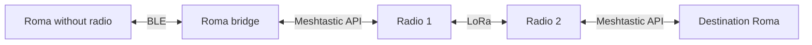

# Architecture

## Native integration first

Use Swift/SwiftUI on Apple and Kotlin/Compose on Android to preserve the existing platform implementations. The initial integration builds from pinned Bitchat source with reviewable Roma overlays. Generated source trees are disposable build outputs; all Roma changes live in this repository.

This keeps the original networking, private-message protocols, channels and platform behavior available while a new Roma domain and interface are developed. It is not a claim that every upstream feature has been validated in the derived app.

## Intended layers

1. Roma presentation: conversations, people, radio and settings, with clearly identified Roma/Bitchat/Meshtastic areas.
2. Roma domain: local identity, verified address associations, persistent history and message states.
3. Routing: compatible-route discovery, queueing, bounded retries, expiration and deduplication.
4. Bitchat and Meshtastic adapters retaining native protocols.
5. Bluetooth and Meshtastic radios.

Meshtastic integration is not present in the first BLE build. Track its implementation separately; retain the upstream clients' configuration, channels, maps, nodes, telemetry and applicable integrations.

## Compatibility boundaries

- Original Bitchat peers use the native Bitchat protocol.
- Original Meshtastic peers use native Meshtastic message formats and channels.
- Roma-to-Roma cross-network messages need a separately specified envelope and authenticated identity mapping. Never merge peers by nickname or treat a shared radio node as one human account.
- A nearby original Bitchat client does not automatically gain arbitrary LoRa addressing.
- A phone without LoRa hardware needs a connected radio or a reachable Roma bridge.

The bridge diagram is a target, not implemented behavior. A bridge must route an opaque, authenticated Roma envelope without silently decrypting and rebroadcasting private messages. Choose an established cryptographic protocol; do not invent a cipher.

## Route and delivery rules to implement

Prefer a usable compatible BLE path, then an available compatible LoRa path. Queue when neither exists. Keep one logical message ID across attempts and routes. Bound fragmentation and retransmission by measured radio limits. Do not forward all BLE discovery, media or control traffic into LoRa.

Transport acceptance, radio acknowledgement and destination-app receipt are different events. A read receipt requires a separate decision and event. Existing internet-dependent upstream modes remain part of the feature inventory; internet fallback for Roma must not be silently introduced.

